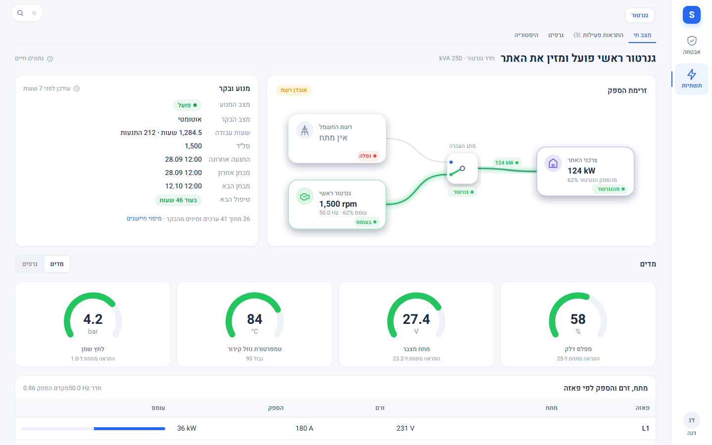

# תשתיות › גנרטור ומעליות

Source: original

## מה זה

מסך צפייה בגנרטור הגיבוי של האתר: מצב חי, זרימת הספק בין הרשת, הגנרטור ומתג ההעברה לצרכנים, פרטי המנוע והבקר, מתח / זרם / הספק
לכל פאזה, גרפים, התראות והיסטוריה. **המסך לקריאה והתראות בלבד** - אי אפשר להתניע, לעצור או לשנות מצב בקר מכאן, והספים
שמגדירים אינם משנים דבר בבקר עצמו.

הלשונית "גנרטור" מופיעה תחת **תשתיות** רק כשהמערכת מזהה בקר גנרטור (התקן אחד עם כל החיישנים שלו) ולמשתמש יש הרשאת צפייה.

*צילום מהדגמה: נתוני דמה של גנרטור בעומס בזמן נפילת רשת.*

## איך אני… (מפעיל ומעלה)

1. **רואה מה קורה עכשיו.** תשתיות › גנרטור › **מצב חי**. הכותרת אומרת במשפט אחד: פועל ומזין את האתר / בריצת מבחן / במנוחה.
   שבב כתום "אובדן רשת" מופיע כשהרשת נפלה.
2. **מבין את הזרימה.** התרשים מראה רשת החשמל, הגנרטור, מתג ההעברה והצרכנים, וכמה קילוואט עוברים מהגנרטור.
3. **בודק מנוע ובקר.** מצב המנוע, מצב הבקר (אוטומטי / ידני / כבוי / מבחן), שעות עבודה, התנעות, התנעה ומבחן אחרונים, טיפול הבא.
   אם הבקר אינו במצב אוטומטי, מופיעה תווית "לא אוטומטי".
4. **מחליף בין מדים לגרפים.** מפלס דלק, מתח מצבר, טמפרטורת נוזל קירור ולחץ שמן, עם גבולות ההתראה; ובטבלה מתח, זרם והספק לכל פאזה.
5. **צופה בגרפים.** לשונית **גרפים**: טווחים (שעה, 24 שעות, 7, 30 ימים או טווח מותאם) וייצוא CSV. דגימה מלאה נשמרת 3 ימים, אחר כך
   ממוצע ל-5 דקות.
6. **מאשר התראות.** לשונית **התראות פעילות**: "אישור" להתראה אחת או "אישור הכול", עם הערה לא חובה. **היסטוריה**: חיפוש וסינון לפי
   חומרה, סוג ומצב.
7. כשהקשר לבקר נקטע, המסך אומר "אין תקשורת עם בקר הגנרטור" ומציג את הערכים האחרונים שנקלטו עם זמן - לא ערכים שנראים חיים.

## איך אני… (מנהל אתר / מנהל מערכת)

הגדרות › תשתיות › **גנרטור**:

1. **זיהוי.** המסך מראה אם נמצא גנרטור ואילו חיישנים חסרים; "בדיקה חוזרת" או בחירת התקן ידנית.
2. **מיפוי חיישנים.** כל חיישן של הבקר משויך לתפקיד; מתקנים שיוך שזוהה לא נכון.
3. **ספי התראה.** לחץ שמן מינימלי, טמפרטורה מקסימלית, דלק נמוך וכדומה.
4. **שמירת נתונים.** ימי היסטוריית התראות וגרפים, וזמן עד סימון "אין תקשורת".
5. **ניתוב התראות.** **מתחיל ריק**: עד שבוחרים נמענים לכל סוג התראה, ההתראות נשמרות במרכז ההתראות בלבד. לכל התראה בוחרים
   חומרה, נמענים (לפי תפקיד או משתמש), ערוצים, דקות עד הסלמה ונוסח הודעה בעברית עם תצוגה מקדימה.
6. **הרשאות.** צפייה והתראות (`generator.view`: מפעיל ומעלה) וניהול והגדרות (`generator.manage`: מנהלי אתר ומערכת).

## מגבלות

- נבדק מול נתוני דמה ובקר מדומה בלבד; **לא נבדק מול בקר גנרטור אמיתי**. אחרי החיבור הראשון כדאי לבדוק את מיפוי החיישנים.
- אין שליטה בגנרטור, ואין התנעה או עצירה מהמסך.
- מסירת ההתראות בפועל נעשית דרך מרכז ההתראות ולפי הערוצים שהוגדרו שם.

## שים לב

- אישור התראה נרשם ביומן הביקורת עם שם המשתמש.
- ערך שהבקר לא דיווח מוצג כחסר, ולא כאפס.

## מעליות (תשתיות)

> **גרסה 2.8.0.** מסך המעליות עוצב מחדש, נוספו כרטיס מעליות במסך הראשי, היסטוריה של 24 שעות והתראות. עד גרסה 2.7.3 היה רק מצב חי
> בסיסי, בלי היסטוריה ובלי התראות.

**מה זה.** מעקב חי אחרי מעליות שהוגדרו בתשתיות. כל מעלית מקושרת לחיישני מצב (פתוח / סגור) שהמערכת רואה. **המסך לקריאה בלבד:**
אין שליטה במעלית, אין התנעה ואין שינוי מצב. כשלא הוגדרה אף מעלית לא מופיעה לשונית, לא מופיע כרטיס ולא נשלחת התראה.

### הגדרת מעלית (מנהל)

1. **הגדרות › תשתיות › מעליות › הוספה**, או במסך המעליות עצמו: תפריט המשתמש › **עריכת דף** › הכפתור **מעלית חדשה** (מ-2.9.0 הכפתור וכרטיס ההוספה
   מופיעים **רק במצב עריכת דף**, ולסיום לוחצים **סיום**; במצב רגיל הם מוסתרים, גם כשאין עדיין מעליות).
2. כותבים שם, בוחרים אזור (לא חובה) ובוחרים חיישן לכל תפקיד: **ממתינה, תקלה, פיקוד כבאים, השבתה**. אפשר להוסיף עד ארבעה חיישנים
   נוספים עם שם. מספיק חיישן אחד.
3. בחלון ההגדרה מוצגת שורה "עולה / יורדת / דלת פתוחה / קומה - לא מוגדר (אפשר להוסיף בעתיד)": בהתקנה הנוכחית אין חיישני כיוון, ולכן
   אין חץ כיוון בשום מקום. מעלית שכבר מקושרת לתפקיד כזה ממשיכה להציג אותו בחלון.
4. הסדר ברשימה נקבע עם **למעלה / למטה**. מחיקת מעלית מבקשת אישור. הרשאה לניהול: `infra.elevators.manage` (מנהלי אתר ומערכת).

### המסך תשתיות › מעליות

- **שורת מספרים:** ממתינות או פעילות, בתקלה, בהשבתה, בפיקוד כבאים.
- **כרטיס לכל מעלית:** אייקון דלת, מצב במילים, "מלפני ..." (כמה זמן במצב הזה), נוריות החיישנים (עם הסבר במילים, למשל "תקלה: פעיל")
  ופס של 24 השעות האחרונות עם סיכום בטקסט של מספר השעות בכל מצב. הרענון הוא כל 15 שניות.
- **היסטוריית 24 השעות** מוצגת רק למי שרואה את **כל** החיישנים של אותה מעלית (ההיסטוריה נגזרת מכולם); לאחרים הפס לא מוצג.
  ההיסטוריה נשמרת 8 ימים. תקופה שבה המערכת כבויה מוצגת כמצב האחרון שנרשם לפני הכיבוי, עד הבדיקה הראשונה אחרי ההפעלה.
- **צבעים (וגם צורה, לא רק צבע):** ממתינה - ירוק; פעילה - כחול; תקלה - אדום; **בהשבתה - כתום חזק עם שוליים מפוספסים**;
  **פיקוד כבאים - ארגמן ופועם** (הפעימה נעצרת כשהמכשיר מוגדר להפחתת תנועה); לא ידוע - אפור.

### סדר העדיפות של המצב

פיקוד כבאים › תקלה › בהשבתה › פעילה › ממתינה › לא ידוע. כל תפקיד נבדק לפי החיישן **שלו**, כך שתקלה שמוסתרת על המסך מאחורי פיקוד
כבאים עדיין נחשבת תקלה להתראות. חיישן לא זמין לא נחשב; כשאין אף חיישן זמין, כשהמעלית מושבתת, או כשהחיבור לתשתית לא מסונכרן, המצב הוא
"לא ידוע".

### כרטיס המעליות במסך הראשי

- נפתח ב**הגדרות › תשתיות › מעליות › תצוגה במסך הראשי** (למי שיש לו הרשאת הגדרות מערכת; לאחרים מוצגת שורה שאומרת זאת):
  הדלקה וכיבוי של היישומון, **אופן התצוגה** (כרטיס אחד לכל המעליות / כרטיס לכל מעלית / שניהם), גודל ברירת מחדל (קטן / בינוני / גדול),
  **מה מציגים** (כל המצבים או רק תקלה / השבתה / פיקוד כבאים) ובחירת המעליות שמוצגות.
- המיקום והגודל נקבעים במצב עריכה של המסך הראשי, כמו שאר היישומונים. היישומון מופיע רק למי שרואה לפחות מעלית אחת.
- מי שיש לו הרשאה להתאמה אישית של המסך (`screen.personalize`) יכול לבחור לעצמו אופן תצוגה ולהסתיר מעליות ("מעליות: התצוגה שלי"). הסתרה
  אישית **מתווספת** לרשימה של ההתקנה ולא מחליפה אותה, ומה שהמנהל הסתיר אינו זמין לבחירה.
- הכרטיסים הקטנים של גרסה 2.7.x בשורת המספרים של המסך הראשי הוסרו; את מקומם תופס היישומון (אופן "כרטיס לכל מעלית").

### התראות מעליות (כבוי כברירת מחדל)

ב**הגדרות › תשתיות › מעליות › התראות מעליות** (שינוי: הרשאת הגדרות מערכת; מנהלי מעליות רואים את ההגדרות לקריאה בלבד):

1. **שליחת התראות מעליות** - מתג ראשי, **כבוי**. ולכל מצב מתג משלו: **פיקוד כבאים, תקלה, בהשבתה** - גם הם כבויים. מצב שולח התראה רק
   כשהמתג הראשי וגם המתג שלו דולקים.
2. **נמענים לכל מצב:** תפקידים, משתמשים בשמם וקבוצות. **לא נבחר אף אחד = אף אחד לא מקבל.** ההתראה מגיעה רק למי שמורשה לראות את המעלית
   (ולהתראה על מצב מסוים - למי שרואה את החיישן של אותו מצב).
3. **ערוצים:** מרכז ההתראות תמיד; התראת דפדפן ואפליקציית הטלפון לפי בחירה. דוא"ל ו-WhatsApp **לא זמינים** להתראות מעליות.
4. **מה קורה בהדלקה ובכיבוי:**
   - הדלקה שולחת התראה רק על מצב שמתחיל **מעכשיו**. מצב שכבר היה קיים בעת ההדלקה לא יקבל התראה בדיעבד; רק ההתחלה הבאה שלו.
   - כיבוי (של המתג הראשי או של מצב) סוגר מיד את ההתראות הפתוחות של המצבים שכובו, ולא משאיר אותן פתוחות. בהתראת פיקוד כבאים נשלחת
     הודעת סיום "התראות המעליות כובו". הדלקה חוזרת לא תשלח שוב מצבים שכבר מתקיימים.
   - המתנה קצרה לפני ההתראה: תקלה והשבתה 30 שניות, פיקוד כבאים מיד.
   - חיישן שהוסר מהתשתית סוגר את ההתראה הפתוחה שלו מיד; חיישן שאין לו ערך חי שעה שלמה סוגר אותה אחרי שעה. מעלית שנמחקה סוגרת את
     ההתראות שלה.
5. הדלקת מצב בטבלת ההתראות הכללית **לא** מפעילה התראות מעליות בעצמה: חייבים להדליק גם כאן.

### מה חדש בגרסאות 2.9.0 ו-2.9.1

- **היסטוריה בלחיצה ארוכה (2.9.0).** לחיצה ארוכה (חצי שנייה) על כרטיס מעלית פותחת את היסטוריית 24 השעות שלה, כמו במסך ההתקנים. אפשר
  גם Alt+Enter, מקש התפריט במקלדת, לחיצה ימנית וכפתור היסטוריה גלוי. אין נתונים חדשים. ההרשאה לראות את ההיסטוריה לא השתנתה:
  רק מי שרואה את כל החיישנים של המעלית.
- **"בנסיעה" (2.9.1, לכל מעלית, כבוי כברירת מחדל).** בחלון עריכת המעלית אפשרות חדשה: **"הצג נסיעה כשאינה ממתינה וללא תקלה"**
  (`infra.elevators.manage`). כשהיא פעילה, מעלית שאינה בהמתנה ואין לה תקלה, השבתה, פיקוד כבאים, מצב דלת או המתנה מוצגת **"בנסיעה"**
  (תגית, צבע וסמל) במסך, בפס ההיסטוריה ובחלון ההיסטוריה וביישומון במסך הראשי. מספר "בנסיעה" מופיע בשורת המספרים רק כשמעלית כלשהי משתמשת
  באפשרות. מעליות בלי האפשרות נראות בדיוק כמו קודם. **זה מצב מחושב מחיישני ההמתנה והתקלה, לא כיוון ולא מספר קומה.**
- **עצירת המערכת (2.9.1).** כשהמערכת נעצרה (או שהמעריך לא רץ) יותר מדקה, ההיסטוריה רושמת את הפער כ**"לא ידוע"** מהדופק האחרון, ולא
  מותחת את המצב האחרון על פני ההפסקה.
- **מספר קומה לא נבנה:** במודל המעלית אין תפקיד של חיישן מספר קומה.
- **שורת העמודים במסכי התשתיות (2.9.1).** בגנרטור ובמוני החשמל (מצב חי / התראות פעילות / גרפים / היסטוריה) שורת העמודים כבר לא קופצת שורה
  למטה רגע אחרי פתיחת המסך כשמיקום התפריט הנפתח בכותרת הוא 2 עד 4. בצורת התפריט הנפתח היא שבב שני ליד שבב האזור, באותה שורה (גם בטלפון).
  מיקום 1 וצורת הלשוניות כמו קודם.

> **[צילום חסר S293-E1]** תשתיות › מעליות, חלון ההיסטוריה שנפתח בלחיצה ארוכה על כרטיס (וכפתור ההיסטוריה הגלוי), בהיר, דסקטופ ובטלפון 390.
> **[צילום חסר S293-E2]** תשתיות › מעליות במצב עריכת דף: הכפתורים "מעלית חדשה" ו"סיום" וכרטיס ההוספה; לצידו אותו מסך במצב רגיל בלי הכפתורים; מנהל אתר, דסקטופ.
> **[צילום חסר S293-E3]** חלון עריכת מעלית עם האפשרות "הצג נסיעה כשאינה ממתינה וללא תקלה", מנהל מערכת, דסקטופ.
> **[צילום חסר S293-E4]** כרטיס מעלית במצב "בנסיעה" ושורת המספרים עם "בנסיעה", בהיר וכהה, דסקטופ; וכרטיס המעליות במסך הראשי עם אותה מעלית.
> **[צילום חסר S293-E5]** פס ההיסטוריה עם שורת "לא ידוע" אחרי עצירת המערכת (נתוני הדגמה), דסקטופ.

### הרשאות

| פעולה | הרשאה |
|---|---|
| צפייה במסך ובכרטיס | `devices.read` (ולפי הקומות והחיישנים שרואים) |
| הגדרה וקישור חיישנים, עריכה, סדר ומחיקה | `infra.elevators.manage` |
| תצוגה במסך הראשי לכולם, והתראות | הגדרות מערכת (`system.configure`) |
| תצוגה אישית | `screen.personalize` |

### צילומי מסך שעדיין חסרים

- תשתיות › מעליות (`#/infra/elevators`), בהיר וכהה, דסקטופ וטלפון - תפקיד מנהל מערכת.
- חלון הגדרת מעלית (הגדרות › תשתיות › מעליות) - מנהל מערכת.
- כרטיס המעליות במסך הראשי בשלושת האופנים ובשלושה גדלים; "מעליות: התצוגה שלי" - מנהל מערכת ומשתמש עם `screen.personalize`.
- כרטיס "התראות מעליות" - מנהל מערכת.

### מגבלות ושים לב

- נבדק מול מבחנים אוטומטיים ונתוני דמה; **לא נבדק מול מעלית אמיתית**. אחרי החיבור הראשון כדאי לבדוק את מיפוי החיישנים.
- אין מספר קומה, אין חץ כיוון ואין במסך טווח היסטוריה ארוך מ-24 שעות. "בנסיעה" (2.9.1, אם הופעל) נגזר מחיישני ההמתנה והתקלה בלבד.
- ההתראות כבויות עד שמדליקים אותן ובוחרים נמענים. עד אז ההיסטוריה ממשיכה להירשם.
- אין שליטה במעלית מכאן.
