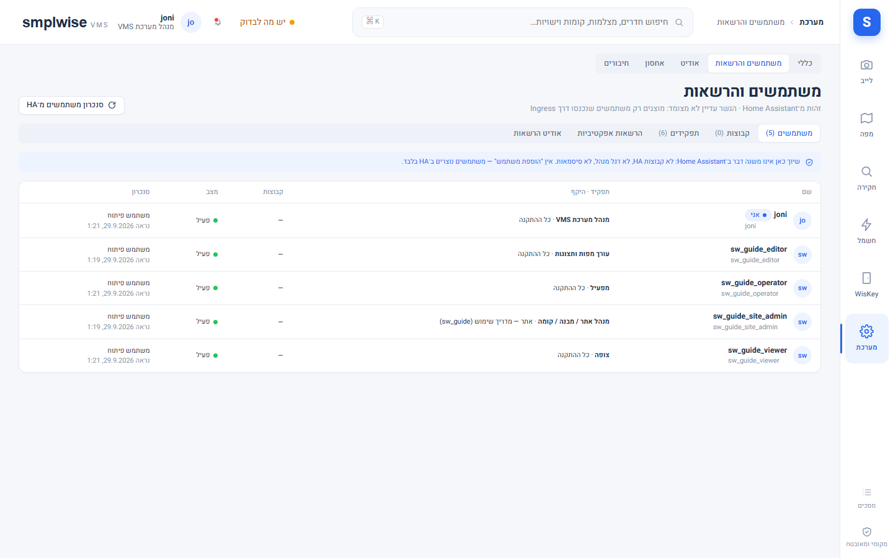
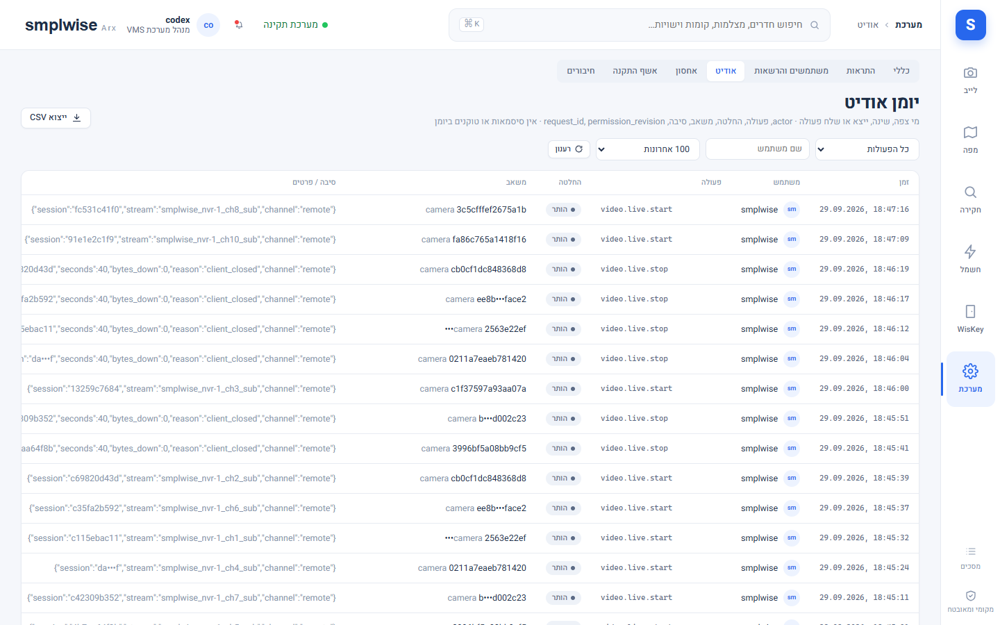

# משתמשים והרשאות

Source: original

## מה זה

מסך "משתמשים והרשאות" (מערכת ← משתמשים והרשאות) הוא מקום ניהול הזהות והתפקידים: חמש לשוניות —
**משתמשים**, **קבוצות**, **תפקידים**, **הרשאות אפקטיביות**, **אודיט הרשאות**. משתמשים עצמם
**מגיעים רק מ-Home Assistant** — אינטגרציית הגשר דוחפת את ספריית המשתמשים (id, שם, username,
פעיל, דגל מנהל, קבוצות) כל דקה. איש לא נוצר כאן, אין סיסמאות כאן, ודגל "מנהל HA" מוצג כמידע בלבד
ולא מקנה שום דבר במוצר.

## איך אני… (מנהל מערכת / מנהל אתר — לשונית משתמשים)

1. **רואה את כל המשתמשים.** טבלה עם שם, מצב (פעיל/מושבת ב-HA), מנהל HA (מידע בלבד — לא תפקיד
   VMS), סנכרון (מתי הספרייה עודכנה מ-HA לאחרונה), תפקיד/היקף.
2. **מסנכרן ידנית.** "סנכרון משתמשים מ-HA" מבקש דחיפה מיידית מהאינטגרציה במקום לחכות לדקה
   הבאה.
3. **משייך תפקיד (`rbac.assign`).** בוחרים תפקיד + היקף (כל ההתקנה / אתר / מבנה / קומה) למשתמש
   או לקבוצת VMS. "שמור שיוך" כותב ומבוקר עם diff לפני/אחרי; "ביטול שיוך" מסיר.
4. **מבין מה קורה כשמשתמש מושבת ב-HA.** הגישה נלקחת בדחיפת הספרייה הבאה (עד 60 שניות): בקשות
   חדשות נדחות, שקעי live/playback פתוחים נסגרים תוך שניות, האודיט שומר את ה-id. **מנהל VMS פעיל
   אחרון לעולם לא מוסר רק בגלל שדחיפה השמיטה אותו** (last-admin guard).
   **אימות דו־שלבי למשתמש:** בתחתית מגירת המשתמש יש שורת "אימות דו־שלבי בכניסה מרחוק" עם בחירה (לפי ההגדרה הכללית / רשות / חובה),
   לצד מצב האימות והאיפוס. הפירוט ב-`82-second-factor_HE.md`.

## איך אני… (קבוצות, T082)

5. **יוצר קבוצה** ("קבוצה חדשה", למשל "עורכי קומה 2") ומוסיף לה חברים.
6. **משייך תפקיד לקבוצה שלמה** — כל חבר יורש את השיוך; ההרשאה האפקטיבית של משתמש היא **איחוד**
   השיוכים שלו עצמו ושל כל הקבוצות שהוא חבר בהן.
7. **רואה תצוגה מקדימה של השפעה** לפני שמירה — לכל שינוי שיוך/חברות, המערכת מציגה מראש איזה
   משתמשים מושפעים.
8. מחיקת קבוצה **נדחית** כל עוד יש בה חברים או שיוכים.

## איך אני… (האצלה למנהל אתר, T082)

9. **מנהל אתר עם `rbac.assign` מואצל** יכול לשייך תפקידים **בתוך האתר שלו בלבד**, בכפוף לארבע
   מגבלות: (א) רק תפקידים ברשימת ההיתר של האצלה (נערכת בלשונית תפקידים; ברירת מחדל
   viewer/operator/editor/kiosk, בתוספת תפקידים מותאמים אישית שסומנו **"ניתן להאצלה"**); (ב) רק
   תפקידים שההרשאות שלהם הוא עצמו מחזיק באותו היקף; (ג) רק למשתמשים בודדים, **לעולם לא לקבוצות**;
   (ד) **לעולם לא תפקיד עם הרשאת מערכת**. חריגה מכל אחת נדחית עם סיבה (`role_not_delegable`,
   `delegation_escalation`, `delegation_groups`) ומבוקרת.
10. **דנייה (deny) על משתמש נשארת כלי של הרשאה מלאה בלבד** — מנהל אתר מואצל לא יכול ליצור או
    להסיר deny.
11. סמכות מלאה (הענקת `system_admin` לדוגמה) דורשת **גם** `rbac.assign` **וגם**
    `rbac.roles.manage` ברמת ההתקנה — לא מספיק להחזיק אחת מהן.

## איך אני… (לשונית תפקידים, מנהל מערכת)

12. **בונה תפקיד מותאם אישית** מהרשאות רגילות בתוספת **הענקות רגישות** שיש לסמן במפורש (למשל
    `door.unlock`, `alarm.disarm`, `access.people.manage`, `access.cards.capture`,
    `devices.control_bulk`). תפקיד מותאם אישית **לעולם לא** נושא הרשאת מערכת (ניהול תצורה/תפקיד/
    קישור); תפקידים מובנים (viewer/operator/editor/kiosk/site_admin/system_admin) **אינם ניתנים
    לעריכה**.
13. לפני שמירה, דיאלוג מציג את **ההשפעה** (קישורים, משתמשים, קבוצות, היקפים, הרשאות שנוספו/הוסרו).
    השינוי חל על כל סשן מושפע בבקשתו הבאה; עריכה מיושנת נדחית (revision); תפקיד שעדיין מקושר לא
    ניתן למחיקה.
14. מסמנים תפקיד "**ניתן להאצלה**" כדי שמנהל אתר יוכל לשייך אותו בעצמו.
15. **אימות דו־שלבי לתפקיד:** בכל כרטיס תפקיד יש בחירה (לפי ההגדרה הכללית / רשות / חובה) שחלה על כל מי שמשויך אליו; די בתפקיד אחד
    עם "חובה" כדי שהמשתמש יידרש לאימות. ראו `82-second-factor_HE.md`.

## איך אני… (לשונית הרשאות אפקטיביות והרשאות מיוחדות בהיקף WisKey)

15. **"הרשאות אפקטיביות"** מחשבת בצד השרת מה משתמש נתון באמת רשאי לעשות בהיקף נתון — בלי
    התחזות (impersonation), רק חישוב.
16. הרשאות WisKey הרגישות: `access.read` (viewer ומעלה) — צפייה בלבד; `access.doors.open`
    (site_admin/system_admin/"פותח דלתות") — פתיחת דלתות בלבד (השם הקודם `access.release` עדיין פועל בתפקידים
    מותאמים ישנים); `access.call` (מפעיל ומעלה) — מענה/דחייה/ניתוק והכרזות; `access.people.manage`
    (site_admin/system_admin) — עורך האנשים; `access.cards.capture` (site_admin/system_admin,
    בנוסף ל-people.manage) — קליטת כרטיס. כדי לתת למישהו רק עריכת אנשים בלי כל תפקיד מנהל אתר —
    בונים תפקיד מותאם אישית שמפרט את `access.people.manage` בין הרשאותיו הרגישות.

## הרשאות התזמונים (CR-014)

שלוש הרשאות חדשות: `schedule.view` (צפייה בתזמונים), `schedule.manage` (ניהול תזמונים - רגישה, אינה מרומזת) ו-
`schedule.sensitive` (תזמון אזעקה, מנעולים, דלתות ושערים - רגישה, אינה מרומזת). ברירת מחדל: מנהל אתר - צפייה וניהול בהיקפו;
מנהל מערכת - שלושתן; אחרים - אין. לעורך תזמונים בלבד בונים תפקיד מותאם "עורך תזמונים" (הרשאות רגילות: צפייה בתזמונים,
צפייה בחשמל והתקנים, שליטה בהתקן בודד; רגישה: ניהול תזמונים) ומשייכים אותו בהיקף הרצוי. כדי לערוך תזמון צריך גם שליטה בכל
ההתקנים שבו. המתכון המלא, כלל ההיקף והמגבלות ב-`80-settings_HE.md` (הגדרות › תזמונים).

## הרשאות האוטומציות, הסצנות והסקריפטים (CR-017)

חמש הרשאות (פירוט, ברירות מחדל והסבר בעמוד `43-automations_HE.md` ו-`80-settings_HE.md` › אוטומציות): `automation.manage` (יצירה, עריכה,
הפעלה/השבתה, הרצה ומחיקה של אוטומציות - **רגישה, אינה מרומזת**; **אין הרשאת צפייה בלבד**), `scene.manage` (יצירה, צילום ועריכה של סצנות -
רגישה), `script.run` (הפעלת סקריפטים), `script.manage` (יצירה ועריכה של סקריפטים - רגישה) ו-`automation.code_view` (המתג "בונה · קוד" - רגישה).
ברירת מחדל: מנהל אתר ומנהל מערכת. **הפעלת סצנה** אינה הרשאה נפרדת אלא שליטה בהתקנים של הסצנה. תפקיד מותאם מקבל הרשאה רגישה רק אם
ציין אותה במפורש בין ההרשאות הרגישות שלו. כל ההרשאות בהיקף הקומות והאזורים, ושינוי של צעד רגיש דורש את הרשאת השליטה הידנית המקבילה.

## הרשאות המולטימדיה (CR-015, CR-016)

שבע הרשאות מכסות את מסכי הטלוויזיה והשלט ואת הנגנים, הרמקולים והקבוצות (ראו `42-multimedia_HE.md`):

| הרשאה | תווית | רגישה |
|---|---|---|
| `media.read` | צפייה במסכים ובמולטימדיה | לא |
| `media.control` | שליטה במסכים: עוצמה, מקשים וניגון | לא |
| `media.power` | הדלקה וכיבוי של מסכים והחלפת מקור | לא |
| `media.public` | מסכים ציבוריים: החלפת מקור ואפליקציה והקלדה | **כן - אינה מרומזת** |
| `media.bulk` | כיבוי מרוכז של מסכים בקומה או באזור, עצירת מוזיקה בקומה וקבוצה לכל הבניין | **כן - אינה מרומזת** |
| `media.layout` | עריכת מסך המולטימדיה והשלט, קבוצות שמורות ורשימת המועדפים | לא |
| `media.group` | קיבוץ רמקולים וקבוצות שמורות: צירוף ופירוק חדרים, עוצמת קבוצה והפעלת קבוצה שמורה (דורש גם `media.control` בכל חדר) | לא |

שתי הרשאות נוספות (שלב 2ב של CR-016) קשורות לנגן עם החיבור הישיר לשרת המוזיקה: `media.browse` (עיון וחיפוש בספריית המוזיקה) ו-`media.queue`
(עריכת תור הניגון: הזזה, מחיקה, "נגן הבא" וניקוי; דורשת גם `media.control`). שתיהן אינן רגישות, וברירת המחדל: מפעיל, מנהל אתר ומנהל מערכת.
תפקיד מותאם מקבל אותן רק אם ציין אותן.

ברירת מחדל: צופה, מפעיל, עורך, מנהל אתר ומנהל מערכת - צפייה (כמו צפייה בחשמל והתקנים; לא קיוסק); מפעיל, מנהל אתר ומנהל מערכת - שליטה
והפעלה וקיבוץ; מנהל אתר ומנהל מערכת - מסכים ציבוריים, כיבוי מרוכז ועריכה. כולן בהיקף של המסך (קומה או אזור לפי המיקום של ההתקן הראשי שלו).
תפקיד מותאם מקבל את שתי הרגישות רק אם ציין אותן במפורש בין ההרשאות הרגישות שלו, ולכן "מפעיל מסכים" רגיל אינו יכול להחליף מקור
במסך ציבורי ואינו מכבה קבוצתית. הגדרות, אישור מסכים, איחוד ופיצול, סימון ציבורי, פרופילים ומגברים מקושרים דורשים `system.configure`;
פריסה אישית של מסך המסכים דורשת `screen.personalize`.

**שליטה מהכרטיסים הישנים:** `devices.control` ו-`ha.entity.control` אינם שולטים יותר במסך שאושר בהגדרות (סמכות אחת). בשדרוג, תפקידים
מותאמים שהחזיקו צפייה בחשמל והתקנים מקבלים צפייה במסכים, ומי שהחזיק שליטה בהתקנים מקבל שליטה והפעלה במסכים. המתכון ל"מפעיל מסכים",
ההיקף ופירוט המגבלות - ב-`80-settings_HE.md` (הגדרות › מולטימדיה).

## הרשאות חדשות בגרסאות 2.x

| הרשאה | מה היא מאפשרת | ברירת מחדל |
|---|---|---|
| `analytics.review` | מסך הסקירה של מקליט Frigate וסימון "נסקר" אישי | מפעיל ומעלה |
| `analytics.control`, `analytics.record_control`, `analytics.profile`, `analytics.events` | סוגי הפעולה ב-Frigate (ראו `33-frigate_HE.md`); רגישות | מנהל אתר, מנהל מערכת |
| `analytics.exports`, `analytics.cases` | ייצואים ותיקים ב-Frigate (מגרסה 2.3.0, בשרת בלבד, בלי מסך; ייצוא דורש גם `video.export`); רגישות | מנהל אתר, מנהל מערכת |
| `media.announce` | הכרזה קולית ברמקולים מורשים והכרזת חירום בלחיצה אחת; רגישה | מכריז (תפקיד מובנה), מנהל אתר, מנהל מערכת |
| `media.cast` | שידור מצלמה למסך מורשה | מפעיל ומעלה |
| `generator.view` / `generator.manage` | צפייה והתראות בגנרטור / הגדרות וניהול | מפעיל ומעלה / מנהל אתר ומערכת |
| `wall.view` | ממשק מסך הקיר (תפקיד kiosk) | תפקיד kiosk |
| `presence.report` | דיווח נוכחות מאפליקציית הטלפון | כל התפקידים הרגילים |
| `infra.elevators.manage` | הגדרת מעליות וקישור חיישנים (הגדרות › תשתיות › מעליות); צפייה ב`devices.read`; ראו `44-generator_HE.md` | מנהל אתר, מנהל מערכת |
| `infra.temperature.manage` | הגדרת יחידות טמפרטורה, ברירות מחדל, חלונות הפשרה נלמדים, דוחות ומצב עריכת דף (2.9.2; חלון תחזוקה ב-2.9.3 דורש `infra.temperature.ack`); ראו `51-temperature_HE.md` | מנהל אתר, מנהל מערכת |
| `infra.temperature.ack` | אישור התראות טמפרטורה, השתקת אזהרות וחלון תחזוקה ליחידה (2.9.2, ו-2.9.3 לחלון התחזוקה) | מפעיל, מנהל אתר, מנהל מערכת |
| `tickets.handlers` | ניהול מטפלים וספקים במחלקות שאני מנהל, בלי הרשאת הגדרות (2.6.4); ראו `46-tickets_HE.md` | מנהל מערכת; לאחרים דרך התפקיד `tickets_handlers` |
| `tickets.directory` | ספריית אנשי הקשר והספקים בלי `tickets.configure` (יצירה, עריכה, מחיקה, ייצוא, טלפונים מלאים); `tickets.configure` ממשיכה לכסות; 2.9.3, ענף `pilot/SMALL-294`; ראו `46-tickets_HE.md` | מנהל מערכת; לאחרים דרך התפקיד `tickets_directory`; לא ניתנת להאצלה |
| `tickets.technician_requests` | אישור או דחייה של בקשות טכנאי מספקים (2.7.0); אזור הבקשות כבוי כברירת מחדל | מנהל מערכת; לאחרים דרך התפקיד `tickets_technician_requests` |
| `users.ha_manage` | הלשונית "משתמשי מערכת הבית" (2.6.4); המסך לא נבדק מול מערכת חיה, ראו `47-identity-users_HE.md` | מנהל מערכת בלבד |
| `alarm.bypass` | "דריכה עם עקיפה" ועקיפת חיישן באזעקה; מ-2.7.0 נדרשת גם למשתמשי מערכת הבית, בנוסף ל-`alarm.arm`; רגישה | לפי מתן ההרשאה |
| `access.external.grant` | אישור קוד דלת זמני לטכנאי של ספק (2.7.0); **נעולה בקוד בגרסה הזו, אין דרך להפעיל**; רגישה ובהיקף עמדה, מחזיק מובנה: מנהל מערכת בלבד; ראו `47-identity-users_HE.md` ו-`52-external-access_HE.md` | - |

בגרסה 2.9.3: **הרשאות אישיות בעמדה** (עקיפות מתן ושלילה של אדם ב-WisKey) נחשבות עמדות של האדם בבדיקת הכתיבה (ראו `50-wiskey_HE.md`); ההרשאה `tickets.directory` (בטבלה למעלה) טרם מוזגה; מסך גישת חוץ דורש `access.external.grant` בכל עמדה, וכתיבות בו נעולות (`52-external-access_HE.md`). בגרסאות 2.9.0 עד 2.9.2: אישור טכנאי (`tickets.technician_requests`) מוגבל למחלקות של המאשר (2.9.0); חשבון ההתראות של סיכומי הטמפרטורה בוואטסאפ נקרא `infra.temperature.reports` (שימוש, לא הרשאה למשתמש).

אימות דו-שלבי אינו הרשאה אלא הגדרה אישית של כל משתמש ומדיניות של מנהל (`82-second-factor_HE.md`).

## איך אני… (לשונית אודיט הרשאות)

17. **"יומן אודיט"** (מערכת ← יומן אודיט) מציג שורה לכל פעולה מורשית/נדחית: זמן, משתמש, פעולה,
    משאב, החלטה (allowed/denied — כולל הסיבה), תפקיד/היקף ששימשו. שורות נשמרות `audit.retention_days`
    (ברירת מחדל 365 יום).

## שים לב

- כל שינוי שיוך, קבוצה או תפקיד מקדם **גרסת הרשאה (revision)** ונכנס לתוקף מיד; עריכה על גרסה
  מיושנת נדחית, לא דורסת בשקט.
- כל שינוי שיוך/חברות בבאצ' (`POST /access/bindings/bulk`, עד 50 פריטים) הוא **all-or-nothing** —
  הפריט הראשון שנדחה עוצר את כל הבקשה עם האינדקס וה-id שלו.
- אף כתיבת שיוך/חברות לא יכולה להשאיר את ההתקנה **בלי מנהל מערכת פעיל אחד לפחות** (409
  `last_admin`), כולל deny על עצמך.
- הרשאות אמיתיות תמיד נבדקות **בצד השרת** על המשאב עצמו — מצלמה נגישה רק דרך קומה שהמשתמש רשאי
  לראות, ומניעה מפורשת בקומה סופית אפילו למשתמש כל-ההתקנה.

*צילום מהמערכת החיה.*

*צילום מהמערכת החיה.*
