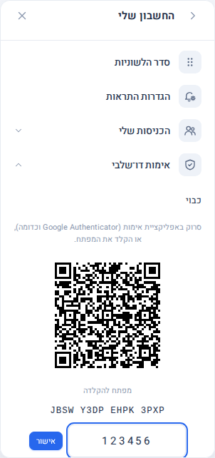
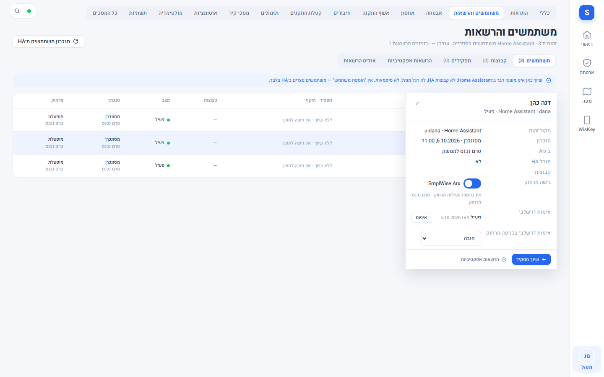
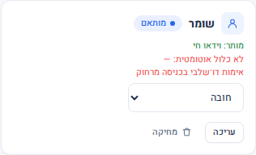
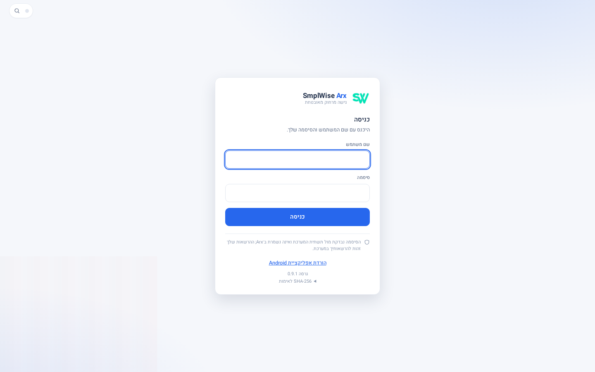

# אימות דו-שלבי, מפתחות גישה, אישור לפני שינויים והורדת אפליקציית Android

Source: original

> עודכן לגרסה 2.51.0 (MFA-REVIEW-DOCS-2520). גרסה באנגלית: `docs/user-guide/en/82-second-factor_EN.md`.
> סקירת האבטחה של המנגנון: `docs/security/MFA-REVIEW-2520.md`.

## מה זה

"דרך אימות נוספת" (גורם שני) היא משהו שיש רק לכם, מעבר לסיסמה. Arx מכיר ארבע:

| דרך | מה זה | איפה היא עובדת |
|---|---|---|
| **קוד מאפליקציית אימות** | קוד בן 6 ספרות שמתחלף כל חצי דקה (Google Authenticator, Microsoft Authenticator וכדומה) | כניסה מרחוק, אישור לפני שינויים, הסרת הגורם |
| **קודי שחזור** | 10 קודים חד-פעמיים בצורה `XXXX-XXXX`, למקרה שהטלפון אבד | במקום הקוד: בכניסה, בהסרת הגורם, ובאישור רגיל לפני שינויים (לא בכל פעולה, ראו למטה) |
| **מפתח גישה (passkey)** | טביעת אצבע, זיהוי פנים או קוד המכשיר, דרך הדפדפן | אישור לפני שינויים. למשתמשי Arx בלבד (לא משתמשי מערכת הבית) גם בכניסה |
| **מפתח הטלפון** | מפתח שאפליקציית ה-Android יוצרת בטלפון ונפתח בטביעת אצבע או בקוד המסך | בתוך האפליקציה: בכניסה מרחוק ובאישור לפני שינויים |

ומעליהן שלוש הגדרות של מנהל המערכת:

1. **מדיניות אימות בכניסה מרחוק** — מי חייב גורם שני כדי להיכנס מבחוץ. ברירת מחדל: **רשות לכולם**, במצב **דיווח**.
2. **אישור לפני שינויים רגישים** (step-up) — בקשה לאשר שוב את הזהות לפני שינוי הגדרות, משתמשים או הרשאות, ולפני נטרול
   אזעקה, עקיפת חיישן או פתיחת דלת. **כבוי כברירת מחדל**: כשהוא כבוי, הגורם השני נשאל רק בכניסה.
3. **איפוס דרכי אימות של משתמש אחר** — למי שאיבד הכול.

**בלי פעולה של משתמש או מנהל, שום דבר לא משתנה:** אין חובה, אין אישורים נוספים, הכניסה המקומית (מתוך מערכת הבית) לא נשאלת.

## איך אני… (כל משתמש)

הכול נמצא במקום אחד: תפריט המשתמש (האווטאר) › **החשבון שלי** › **אבטחה**. בראש החלק יש סיכום: אפליקציית אימות פעילה או לא,
מספר מפתחות הגישה, מפתחות הטלפון, כמה קודי שחזור נשארו (בכתום כשנשארו מעט), ואסימונים ארוכי טווח.

### להפעיל קוד מאפליקציית אימות

1. **היכנסו מחדש** (צאו והיכנסו) אם הכניסה הנוכחית ישנה מ-5 דקות. מבחוץ, גורם — הראשון **וגם כל גורם נוסף** (מפתח גישה, מפתח
   טלפון, קודי שחזור חדשים) — מוסיפים רק מכניסה טרייה; אחרת מופיעה ההודעה "לפעולה הזו צריך כניסה טרייה". זו הגנה: מי שגנב כניסה
   ישנה לא יכול לשים בחשבון שלכם גורם משלו. ברשת המקומית הכלל לא חל. כשהאישור לפני שינויים פעיל, אישור זהות מספיק במקום (כמו קודם).
2. בחלק "אימות דו-שלבי" לוחצים **הפעלה**. מופיע קוד QR ומתחתיו מפתח להקלדה.
3. סורקים את ה-QR באפליקציית האימות (או מקלידים את המפתח), ומקלידים את הקוד בן 6 הספרות. **אישור**.
4. **מופיעים 10 קודי שחזור — פעם אחת בלבד.** הדפיסו או שמרו אותם במקום בטוח, מחוץ לטלפון.
5. כל הכניסות האחרות שלכם מרחוק מסתיימות (הכניסה הנוכחית נשארת), ותקבלו הודעה בכל המכשירים שנוסף גורם.

*צילום מהדגמה (מגרסה קודמת; הזרימה זהה, החלק נקרא היום "אבטחה"): קוד QR ומפתח בדויים.*

מעכשיו כל כניסה **חדשה** מרחוק מבקשת סיסמה ואז קוד. כניסה פתוחה ממשיכה בלי לשאול.

### קודי שחזור

- כל קוד עובד **פעם אחת**. בחלק "אבטחה" רואים כמה נשארו; כשנשארו 3 או פחות מופיעה אזהרה.
- **קודים חדשים:** "קודים חדשים" › **יצירה** — כל הקודים הישנים מפסיקים לעבוד מיד. מקלידים את הקוד הנוכחי מהאפליקציה (או, מבחוץ,
  נכנסים מחדש בתוך 5 דקות; כשהאישור לפני שינויים פעיל מתקבלים גם מפתח גישה או מפתח הטלפון — **אף פעם לא** קוד שחזור). כל המכשירים
  שלכם מקבלים הודעה שנוצרו קודים חדשים (בלי הקודים עצמם).
- **איבדתם את הטלפון:** בכניסה בוחרים "קוד שחזור" במקום "אפליקציה", נכנסים, ואז ב"אבטחה" מסירים את האימות הדו-שלבי עם קוד
  שחזור נוסף ומפעילים מחדש עם הטלפון החדש.
- קוד שחזור **לא** מתקבל לפעולות שתמיד דורשות אישור משלהן (איפוס של משתמש אחר, חשיפת קוד מפתח הגשר) ולא להוספת גורם
  (קוד חדש, מפתח גישה, מפתח טלפון, קודי שחזור חדשים).

### מפתח גישה (passkey)

1. מנהל המערכת צריך להגדיר קודם את **הכתובת הציבורית** של האתר (בלעדיה מפתחות גישה לא זמינים).
2. "אבטחה" › "מפתחות גישה" › **הוספה**. הדפדפן מבקש טביעת אצבע, זיהוי פנים או את קוד המכשיר.
3. מבחוץ צריך כניסה טרייה (5 דקות), כמו בקוד — גם כשכבר יש בחשבון גורם (כשהאישור לפני שינויים פעיל — אישור זהות במקום).
4. משתמש עם הרשאות ניהול חייב מפתח שמאמת את המשתמש (טביעת אצבע / פנים / קוד מכשיר); הדפדפן מבקש זאת מעצמו.
5. אפשר לתת שם, לשנות שם ולהסיר. מקבלים הודעה בכל מכשיר כשמפתח נוסף **או הוסר**.

**חשוב:** למשתמש של מערכת הבית, מפתח גישה משמש **לאישור לפני שינויים בלבד**. הכניסה מרחוק עדיין מבקשת את הקוד מהאפליקציה (או
את מפתח הטלפון באפליקציה). למשתמשי Arx (חשבונות שנוצרו ב-Arx עצמו) מפתח גישה הוא גם דרך כניסה.

### מפתח הטלפון (אפליקציית Android)

1. מוסיפים מפתח **מתוך אפליקציית ה-Android** (במסך האבטחה של האפליקציה). הטלפון מבקש טביעת אצבע או את קוד המסך. גם כאן, מבחוץ
   צריך כניסה טרייה (גם למפתח נוסף). ביטול מפתח שולח הודעה לכל המכשירים שלכם.
2. מכאן, בכניסה מתוך האפליקציה, הטלפון חותם במקום להקליד קוד, ובאישור לפני שינויים מופיע "אישור במפתח הטלפון".
3. ב"אבטחה" › "מפתחות טלפון" רואים מה פותח כל מפתח ("טביעת אצבע או פנים" / "טביעת אצבע, פנים או נעילת מסך"), אם הוא "מאומת
   בחומרה" או "מפתח תוכנה", מתי נוסף ומתי שימש. **ביטול** מסיר מפתח (טלפון שאבד). מפתח שמסומן "לא נספר" צריך להירשם מחדש.
4. מפתח הטלפון עובד רק בתוך האפליקציה; בדפדפן משתמשים בקוד או במפתח גישה.

### כשמקלידים קוד

- קוד שכבר נעשה בו שימוש נדחה: ממתינים לקוד הבא.
- **אחרי 5 קודים שגויים (כולל קודי שחזור) הקלדת קוד ננעלת ל-10 דקות** (הנעילה נשמרת גם אחרי הפעלה מחדש). למפתח הטלפון
  נעילה נפרדת.

### "אישור זהות" לפני שינוי (כשהמנהל הפעיל אותו)

כשהאישור לפני שינויים פעיל ויש לכם דרך אימות, לפני שינוי הגדרות, משתמשים או הרשאות, ולפני נטרול אזעקה, עקיפת חיישן או פתיחת
דלת, נפתח חלון **"אישור זהות"**: הקוד מהאפליקציה, מפתח גישה, מפתח הטלפון (באפליקציה) או קוד שחזור. אחרי אישור לא נשאלים שוב
למשך הזמן שהמנהל קבע (ברירת מחדל 5 דקות). פעולות מסוימות מבקשות אישור **בכל פעם** ("האישור תקף לשינוי אחד") — שם קוד שחזור
לא מתקבל. ב"אבטחה" השורה "האישור שלך" מראה עד מתי אתם מאושרים.

## איך אני… (מנהל מערכת)

כל ההגדרות של הגורם השני נמצאות ב: הגדרות › **משתמשים והרשאות** › לשונית **אימות דו־שלבי**. רואה אותה מי שיש לו
`system.configure` (עריכה) או `rbac.assign` (צפייה בלבד); מנהל אתר מואצל לא רואה אותה.

### 1. להפעיל "אישור לפני שינויים רגישים"

כרטיס **"אישור לפני שינויים רגישים"**:

| שדה | ערכים | ברירת מחדל |
|---|---|---|
| **לבקש אישור לפני שינויים** | פעיל / כבוי | **כבוי** (רק בכניסה) |
| **משך האישור (דקות)** | 0 עד 30; 0 = בכל שינוי | 5 |
| **גם ברשת המקומית** | פעיל / כבוי | כבוי — הרשת המקומית נשארת דרך חזרה למערכת |

- חל רק על מי שיש לו דרך אימות (קוד, מפתח גישה או מפתח טלפון). מי שאין לו — לא נשאל.
- חיבור עם אסימון ארוך טווח מבחוץ לא נשאל (החלטת בעלים; אפשר לחסום אסימונים כאלה בכרטיס המדיניות).
- **תמיד, גם כשהמתג כבוי,** מבקשות אישור בכל פעם: איפוס דרכי אימות של משתמש אחר, חשיפת קוד מפתח הגשר, והסרת מפתח גישה של
  משתמש Arx אחר על ידי מנהל. **כשהמתג פעיל** מצטרפות: הענקת תפקיד מנהל מערכת ושחזור גיבוי.
- **לפני שמפעילים:** ודאו שלכם עצמכם יש דרך אימות שעובדת, ושמירת ההגדרה עצמה תבקש אישור.
- **מומלץ להפעיל** במערכת שנגישה מבחוץ: כשהמתג כבוי, מי שהשיג כניסה פתוחה של משתמש יכול להוסיף לחשבון גורם נוסף (מפתח טלפון,
  מפתח גישה, קודי שחזור חדשים) בלי שום אישור. ראו "מגבלות".

### 2. מדיניות אימות בכניסה מרחוק

כרטיס **"מדיניות אימות בכניסה מרחוק"** (נבדקת בכל כניסה חדשה מרחוק; ברשת המקומית לא נשאלים):

- **מי חייב אימות דו-שלבי:** רשות לכולם (ברירת מחדל) · חובה למנהלים · חובה למי שמחזיק הרשאות רגישות · חובה לכולם.
- **מצב:** **דיווח** (ברירת מחדל) — המדיניות מחושבת ומוצגת אבל לא חוסמת אף אחד; **אכיפה** — מי שחייב ואין לו גורם לא נכנס
  מרחוק עד שיפעיל (בכניסה מקומית).
- **פטור לעמדות קיר:** פעיל כברירת מחדל.
- **אסימונים ארוכי טווח מבחוץ:** מותרים (ברירת מחדל) · נחסמים למי שחייב אימות · נחסמים לכולם.
- במצב אכיפה, משתמש של מערכת הבית שהפעיל שם אימות דו-שלבי משלה יכול לעמוד בדרישה גם בלי גורם של Arx — אם הכניסה שלו נעשתה
  אחרי שהאימות הזה נראה לראשונה.

כרטיס **"עמידה במדיניות"** מראה כמה משתמשים, כמה חייבים, כמה מהם עם אימות, למי חסר ומי פטור. כשבוחרים מדיניות אחרת ועוד לא
שומרים — מופיעה **תצוגה מקדימה** ("עוד לא נשמר") של מי יצטרך להפעיל. **עברו על הרשימה לפני שעוברים לאכיפה.**

**חריגות למשתמש או לתפקיד:** בכרטיס המשתמש (שורה "אימות דו־שלבי בכניסה מרחוק") ובכרטיס התפקיד בלשונית **תפקידים**: "לפי
ההגדרה הכללית", "רשות" או "חובה". עדיפות: המשתמש, אחריו תפקידיו (די בתפקיד אחד עם "חובה"), אחריהם ההגדרה הכללית. "חובה" סוגרת
את הכניסות הפתוחות מרחוק של מי שאין לו גורם.

*צילום מהדגמה: מגירת משתמש עם שורת מדיניות האימות; נתוני דמה.*

*צילום מהדגמה: כרטיס תפקיד בלשונית "תפקידים"; נתוני דמה.*

**מה רואה מי שחייב ועוד לא הפעיל:** הודעה שמנהל המערכת דורש אימות דו-שלבי, ושצריך להפעיל אותו ב"החשבון שלי" בכניסה מקומית.
לכן לפני "חובה" ודאו שלמשתמש יש כניסה מקומית.

### 3. איפוס דרכי אימות של משתמש (איבד הכול)

1. הגדרות › משתמשים והרשאות › המשתמש › שורת **אימות דו־שלבי**. שם רואים את כל הדרכים שלו: קוד, מפתחות גישה, מפתחות טלפון,
   קודי שחזור שנשארו, והאם נראה אצלו אימות של מערכת הבית.
2. **מבחוץ — היכנסו מחדש קודם** אם הכניסה שלכם ישנה מ-5 דקות; אחרת החלון אומר "לאיפוס מבחוץ צריך כניסה טרייה" ואין כפתור אישור
   (מ-2.52; ברשת המקומית הכלל לא חל).
3. **איפוס**. החלון מראה מה יוסר. **מקלידים את שם המשתמש** שלו לאישור.
4. מאשרים את הזהות **שלכם**: קוד מהאפליקציה, מפתח גישה או מפתח הטלפון — **בכל איפוס מחדש, לא קוד שחזור.**
5. אחרי האיפוס: **כל** דרכי האימות שלו הוסרו (קוד, קודי שחזור, מפתחות גישה, מפתחות טלפון), כל הכניסות והמכשירים שלו נותקו
   (גם התראות הטלפון), הוא מקבל הודעה, **וגם המנהלים** מקבלים הודעה. אם המדיניות מחייבת אותו בגורם — הכניסה הבאה שלו מרחוק
   תבקש להפעיל גורם מחדש (אימות של מערכת הבית לא יספיק עד אז).

מגבלות האיפוס (כל סירוב נרשם ביומן הביקורת):

- לא את עצמכם (לזה יש "הסרה" בחשבון שלכם, עם קוד).
- **עד 3 איפוסים לשעה** לכל מנהל.
- **לא את מנהל המערכת האחרון שיכול להיכנס מרחוק** אם אחרי האיפוס אף מנהל לא יוכל. הוסיפו קודם גורם למנהל נוסף.
- **מבחוץ רק מכניסה טרייה** שלכם (5 דקות) — גם להסרת מפתח גישה של משתמש Arx.
- **מאיפה מותר:** ההגדרה `security.factor_reset_channel` — `any` (ברירת מחדל, מכל מקום) או `local` (רק מהרשת המקומית). לצמצם
  ל-`local` אפשר מכל מקום; **להחזיר ל-`any` אפשר רק מהרשת המקומית**. מ-2.52 ההגדרה חלה גם על הסרת מפתח גישה של משתמש Arx על
  ידי מנהל. כרגע אין לה מסך — משנים אותה דרך ממשק ההגדרות (בקשה למסך רשומה בסקירה).

### 4. מפתחות גישה ומפתחות טלפון — הגדרות מערכת

| מפתח הגדרה | משמעות | ברירת מחדל |
|---|---|---|
| `security.local_public_url` | הכתובת הציבורית; בלעדיה אין מפתחות גישה | ריק |
| `security.passkeys_all_users` | מפתחות גישה לכל המשתמשים (`off` = רק משתמשי Arx; מפתחות שכבר נוצרו לא נספרים) | `on` |
| `security.device_key_auth` | מה פותח את מפתח הטלפון: `biometric_or_screen_lock` או `biometric` בלבד | `biometric_or_screen_lock` |
| `security.device_key_attestation` | אישור חומרה למפתח הטלפון: `off` · `preferred` (נבדק ונרשם, לא חוסם) · `required` (רק מפתח שהחומרה אישרה נספר) | `preferred` |

## הורדת אפליקציית Android

1. הגדרות › גישה מרחוק › כרטיס **"הורדת אפליקציית Android"**: **כתובת הורדה** (https בלבד; ריק = לא מוצג), **תווית גרסה**
   ו-**SHA-256** (לא חובה). הקישור מוצג במסך הכניסה מרחוק רק במכשירי Android, ורק מחוץ לאפליקציה.
2. **APK מובנה:** אם ייכנס לתמונת המערכת קובץ APK חתום, הוא יוצע מעצמו עם גרסה, גודל ו-SHA-256. כתובת שהגדרתם גוברת עליו.

*צילום מהדגמה: כתובת ההורדה בדויה (example).*

## מגבלות — כנות מלאה

- **כשהאישור לפני שינויים כבוי (ברירת המחדל)**, הוספת גורם מבחוץ דורשת רק כניסה של אותה התחברות ב-5 הדקות האחרונות (מ-2.52;
  קודם, גורם נוסף ליד גורם קיים לא דרש דבר). מי שגונב כניסה ב-5 הדקות הראשונות שלה — או יודע את הסיסמה ועובר את הכניסה — עדיין
  יכול להוסיף גורם; כל המכשירים של המשתמש מקבלים אז הודעה. לכלל חזק יותר (קוד, מפתח גישה או מפתח טלפון לפני כל שינוי גורם)
  **הפעילו את האישור לפני שינויים.** ברשת המקומית לא נשאלים (דרך החירום).
- במצב `preferred` (ברירת מחדל) מתקבל גם מפתח טלפון שהחומרה לא אישרה. למערכת רגישה: `required`.
- המשתמש **מקבל הודעה** (מ-2.52, בכל המכשירים: תיבת ההודעות, התראות הדפדפן, האפליקציה) כשגורם נוסף או הוסר, כשנוצרו קודי
  שחזור חדשים וכשמישהו נכנס בקוד שחזור — רק מה קרה, אף פעם לא קוד, שם מפתח או מי עשה זאת (זה ביומן הביקורת). אפשר לכוון את
  ההודעות כמו כל הודעה אחרת בהגדרות › התראות ("שינוי בדרכי האימות של החשבון").
- מנהל שאין לו בעצמו דרך אימות מאפס דרכי אימות של אחרים בלי קוד משלו — מבחוץ רק בתוך 5 דקות מהכניסה (מ-2.52), ועם הקלדת השם
  והמגבלה של 3 לשעה. **לכל מנהל: הפעילו גורם.**
- הגורם השני מגן על הכניסה ל-Arx מבחוץ. הוא לא מגן על מערכת הבית עצמה; אסימון של מערכת הבית הוא אישור כניסה מלא אליה.
- אסימון ארוך טווח מבחוץ לא נשאל לאישור לפני שינויים, גם לא לפני פתיחת דלת או נטרול אזעקה (החלטת בעלים).
- ההגדרה "מאיפה מותר איפוס" אין לה מסך עדיין.
- **אפליקציית ה-Android הנוכחית היא בניית ניסוי (debug).** אל תגדירו כתובת הורדה עד שתהיה בניית שחרור חתומה.
- נבדק מול מערכת בדיקה בלבד: לא עם אפליקציית אימות פיזית שסורקת QR, לא עם מפתח גישה אמיתי ולא עם טלפון אמיתי.

## שים לב

- הסוד של הקוד נשמר מוצפן ולא מוצג שוב; קודי שחזור נשמרים רק כגיבוב (hash). מפתחות גישה ומפתחות טלפון נשמרים כמפתח ציבורי בלבד.
- **שום דרך אימות לא נכנסת לגיבוי**: שחזור לא מחזיר מפתח שהוסר, ובמעבר לשרת חדש כל משתמש מוסיף את הדרכים שלו מחדש.
- הפעלה, הסרה, איפוס, אישור וסירוב נרשמים ביומן הביקורת — בלי קוד, סוד, חתימה או שם מפתח.
- הפעלת קוד או איפוס מבטלים את קודי המכשיר (`arxd_...`) של אפליקציית הטלפון; האפליקציה נרשמת מחדש בכניסה הבאה.
